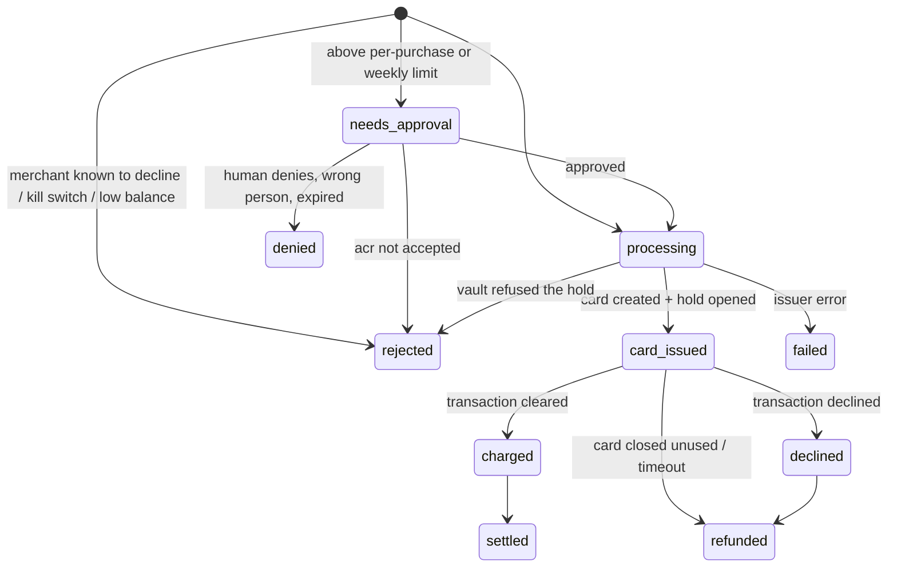

# Backend: the checkout lifecycle

Code: `app/src/server/`. Runs inside the Next.js app (route handlers under `app/src/app/api/`). No separate Express server.

## Modules

| File | Job |
|---|---|
| `config.ts` | Every env var with a safe local default. `modes()` reports which parts are real and which are mocked |
| `types.ts` | Shared types: `User`, `Intent`, `MerchantMemory`, mock issuer and mock World state, `Db` |
| `store.ts` | JSON file store at `app/.data/db.json`, kept on `globalThis`. `write(mutator)` runs one at a time and saves atomically. `read()` is sync |
| `chain.ts` | viem clients for the vault. Reads (`readAccount`, `readHold`, in cents) and operator writes (`openHold`, `cancelHold`, `expireHold`, `forwardReportLocally`). Local-only demo helpers for policy and deposits |
| `intents.ts` | The lifecycle of one checkout. Everything below |
| `users.ts` | The demo user, issuer user provisioning, lookup by agent key |
| `merchants.ts` | Merchant memory: which stores accept or decline these cards |
| `agentcard.ts`, `mock-agentcard.ts`, `card-network.ts` | See [card-issuing.md](card-issuing.md) |
| `world.ts`, `mock-world.ts` | See [human-approval.md](human-approval.md) |
| `settlement-logic.ts` | See [settlement.md](settlement.md) |
| `uniswap.ts`, `cctp.ts` | See [top-up.md](top-up.md) |
| `mcp.ts` | See [mcp.md](mcp.md) |

Money is kept in **cents** in the app. 1 cent = 10,000 USDC base units (6 decimals). `chain.ts` does the conversion.

## Intent states

Every step also appends to `intent.timeline` (type, detail, optional tx hash). The dashboard shows that timeline as the receipt.

## createIntent (`intents.ts`)

Runs in this order, and stops at the first "no":

1. Idempotency: same `idempotency_key` for the same user returns the earlier intent.
2. Merchant memory: if the store is known to refuse virtual cards, reject and lock nothing (unless the agent passes `proceed_if_merchant_declined_before`).
3. Vault policy read: kill switch, balance, per-purchase limit, weekly amount left. Over a limit means `needs_approval`.
4. `lockAndIssue`: create the card first, then `openHold` with `cardRef`. If the hold fails, close the card.

The vault checks the same policy again on-chain, so the backend check is only there to give a nicer answer.

## Card events and settlement

- `/api/webhooks/agentcard` verifies the signature, then `handleIssuerEvent` dedupes by event id and calls `onCharge`.
- `onCharge` records merchant memory. On a decline it closes the card right away, so the card cannot be retried after a refund.
- `requestSettlement`: in `cre` mode it POSTs `{input: {holdId, cardId, intentId}}` to the CRE trigger. If that fails and `SETTLEMENT_FALLBACK_LOCAL` is on, or in `local` mode, `settleLocally` runs the same rules and sends the report through `LocalForwarder`.
- `finalizeFromChain` reads the hold and marks the intent settled or refunded. The chain is the source of truth, not the backend's own guess.

## Reconcile loop

`reconcileOnce` runs every 3 seconds (`ensureBackgroundLoop`) and catches what webhooks miss:

- polls World for approvals that are verifying,
- polls the issuer every 10 seconds per open card for a missed transaction,
- closes cards whose hold has expired and asks for a refund,
- retries settlement every 45 seconds,
- after `expiresAt + settlementGrace`, calls `expireHold` itself. Never for a charged card.

## Decisions

- **Single-flight locks** (`singleFlight(key, fn)`) around approval polling, charge handling and settlement. Two webhooks or a webhook plus the loop used to race (double device-code redemption, double settlement).
- **The loop timer calls `globalThis.__reconcileFn`**, not a captured function, so dev hot reloads never leave old code running.
- **JSON file store.** Enough for a one-user demo, zero setup. Swap for a real DB when multi-user lands. Keep the `read()` and `write()` shape so the swap is local to `store.ts`.
- **One tx at a time per operator key** (`withTxLock`), with a fee floor of at least 25 gwei on non-local chains because Arc has a 20 gwei minimum.
- **Card first, hold second.** The hold must commit to the card id. If the hold fails the card is closed, so nothing usable is left behind.
