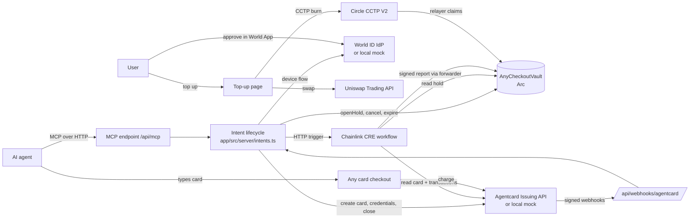
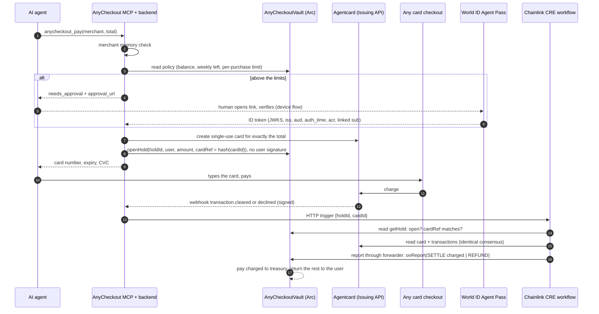

# Overview

AnyCheckout lets an AI agent pay on any website that takes cards, while the user pays in crypto, and only pays what the store actually charged.

The agent calls one MCP tool with the final total. The backend locks that exact amount of USDC in the user's vault on Arc and gets a single-use virtual card from Agentcard for the same amount. The agent types the card into checkout. When the card result comes in, a settlement report pays exactly the charged amount and returns the rest. A decline, an unused card or a timeout returns everything.

Built for ETHGlobal Mumbai (5 to 7 Nov 2026). Testnets and sandbox cards only.

## How these docs work

Each file covers one module: what it does, where the code is, and the decisions behind it. When you change a module, update its file in the same commit. Big choices also go in [decisions.md](decisions.md) with the date and the reason.

| File | Covers |
|---|---|
| [overview.md](overview.md) | This page: the big picture, the repo map, one purchase end to end |
| [contracts.md](contracts.md) | `AnyCheckoutVault` on Arc: balances, policy, holds, settlement, CCTP deposits |
| [backend.md](backend.md) | The checkout lifecycle in the Next.js server: intents, store, chain client, reconcile loop |
| [mcp.md](mcp.md) | The MCP server the agent talks to |
| [card-issuing.md](card-issuing.md) | Agentcard Issuing client, the mock issuer, the demo shops and card network |
| [human-approval.md](human-approval.md) | World ID Agent Pass step-up for purchases above the limits |
| [settlement.md](settlement.md) | The settlement rules and the Chainlink CRE workflow |
| [top-up.md](top-up.md) | Any-token top-up: Uniswap Trading API swap, then CCTP V2 into the vault |
| [frontend.md](frontend.md) | Pages: dashboard, approval page, demo shops, top-up, design system |
| [local-dev.md](local-dev.md) | Running everything locally, env vars, scripts, what is mocked |
| [decisions.md](decisions.md) | Log of key decisions and why |

## Repo map

```
contracts/   Foundry project: AnyCheckoutVault, local-only mocks, tests, deploy script
app/         Next.js 15 app: MCP endpoint, backend, dashboard, approval page, demo shops, top-up
cre/         Chainlink CRE project: the settlement workflow (TypeScript compiled to WASM)
scripts/     local-setup.sh, demo-agent.mjs, deploy-arc.sh, agentcard-setup.mjs, export-abi.mjs
docs/        Hackathon working notes: keys checklist, Arc Studio prompt, World debrief, demo script
architecture/ These docs
```

## The parts and who talks to whom



## One purchase, step by step



If no result ever arrives, the backend closes the unused card and refunds. After `expiresAt + settlementGrace` anyone can call `expireHold` on-chain for a full refund, so money can never get stuck.

## Sponsor map

| Sponsor | What it does here | Main code |
|---|---|---|
| Arc | The escrow vault and the USDC it holds | `contracts/src/AnyCheckoutVault.sol` |
| Chainlink CRE | Reads the real card result and writes settle or refund on-chain | `cre/settlement/main.ts` |
| World ID Agent Pass | The human check above the agent's limits | `app/src/server/world.ts` |
| Uniswap API | Swaps any token to USDC for top-ups | `app/src/server/uniswap.ts`, `app/src/app/topup/page.tsx` |
| Agentcard | The single-use virtual cards | `app/src/server/agentcard.ts` |
| Circle CCTP V2 | Moves the swapped USDC to Arc, straight into the vault | `app/src/server/cctp.ts`, `claimBridgedDeposit` in the vault |

## Known gaps (V1)

- One demo user. No sign-in yet.
- Above-limit approvals are checked by the backend and recorded on-chain as `approvalRef`, but the vault does not verify them itself.
- No RFC 9470 step-up challenge for MCP clients. The agent gets an `approval_url` instead.
- No treasury rebalancing from Arc back to the Agentcard company wallet.
- Agentcard Issuing limits for a real launch: no cards for people in India, ID checks for every user, a $5,000 monthly cap, and terms that bar running it for other people.
